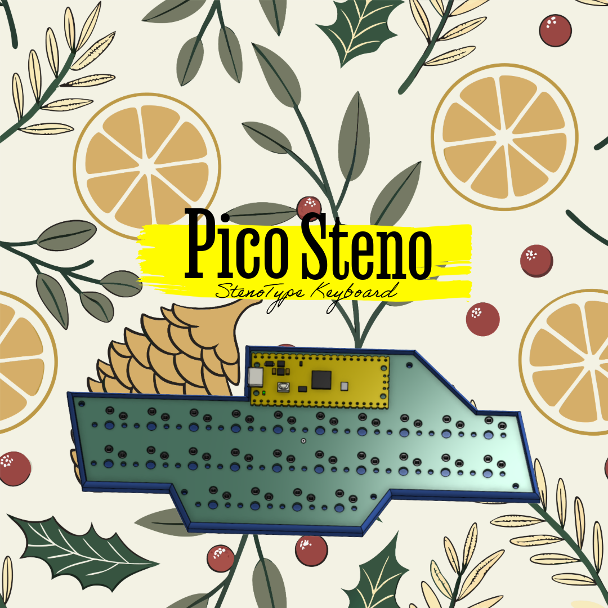
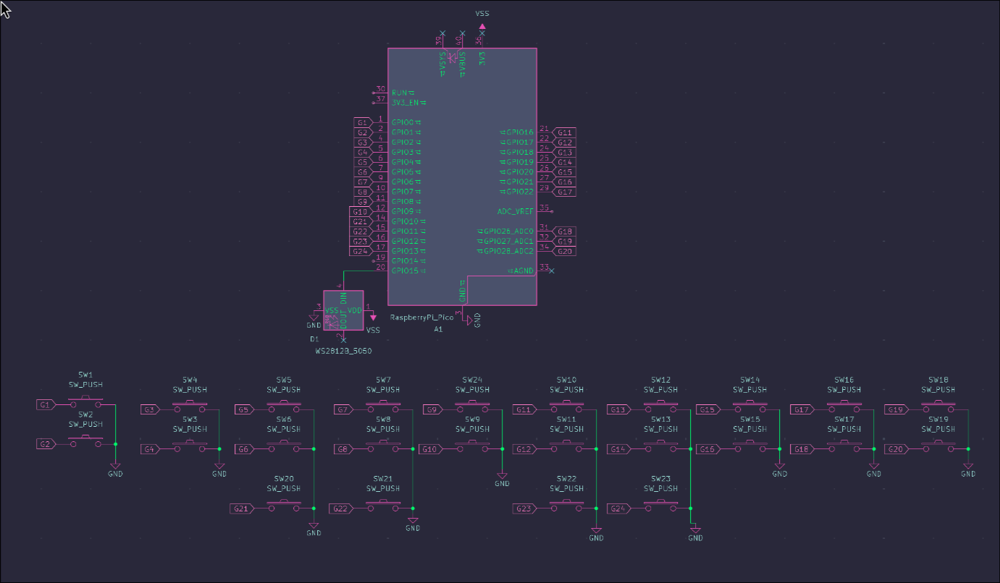
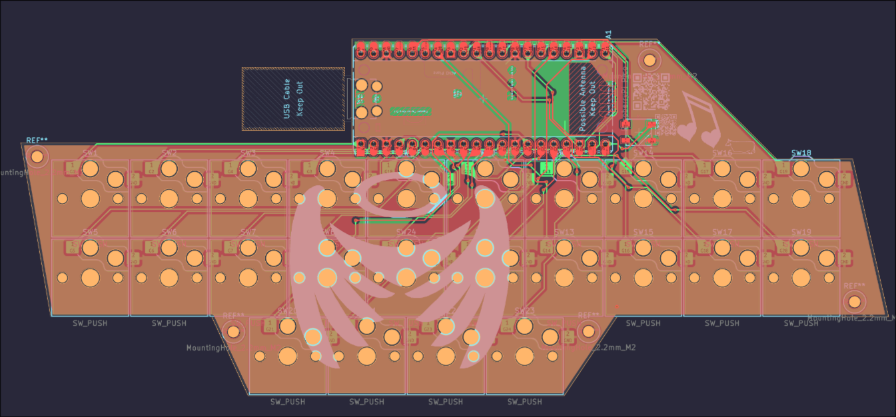
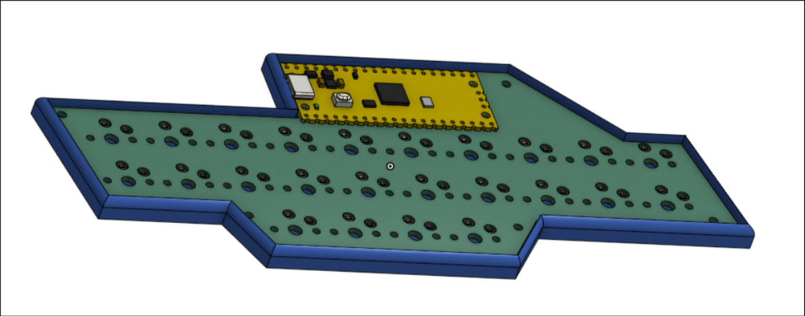
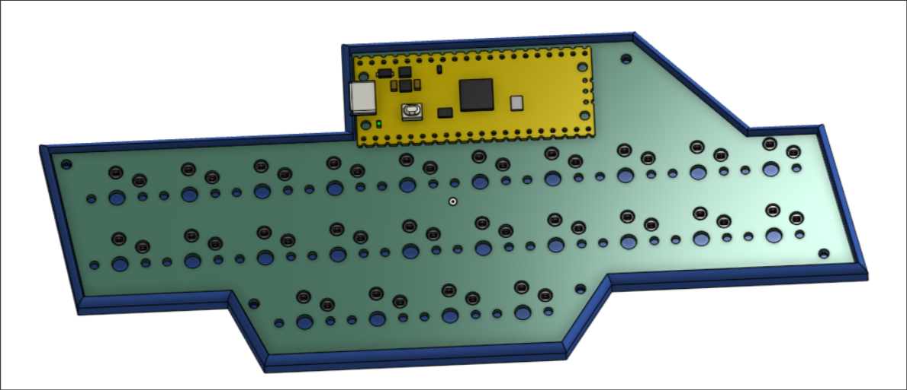
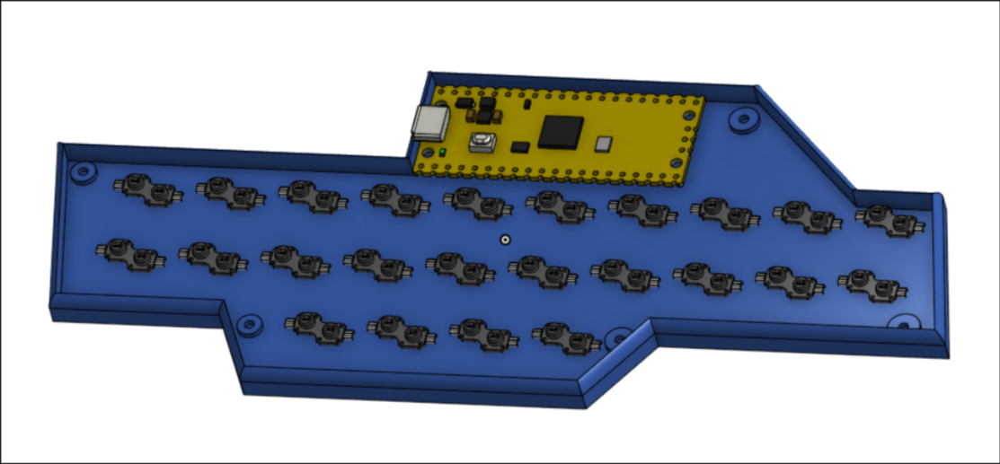
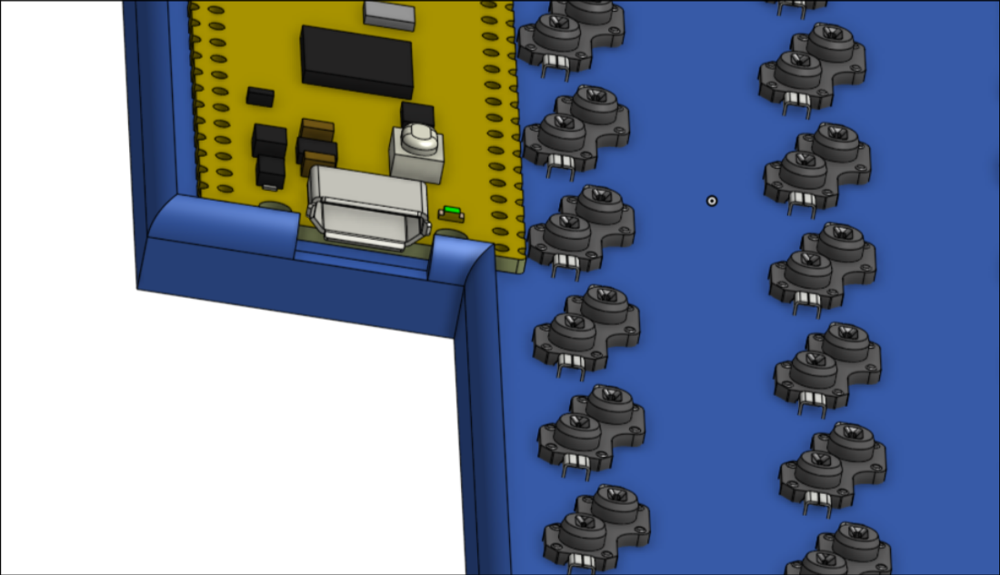

# PicoSteno

A custom, 24-key stenotype keyboard powered by a raspberry pi pico. This board has direct pin wiring (meaning zero diodes) and low-profile Kailh Choc v1 switches (which are hot swappable) for an good stenography experience.

## Why?
I build this because I really wanted to try out steno keyboards but they are quite pricey so I couldn't buy em so I decided to make my very own full size steno keyboard.

## Gallery

## Features
- **Microcontroller:** Raspberry pi pico
- **Switches:** Kailh Choc v1 low profile (Hot swappable)
- **Status Indicator:** WS2812B 2020 RGB LED
- **Firmware:** QMK (using the `geminipr` protocol)

## Firmware Flashing
1. Download the `picosteno.uf2` file
2. Hold the boot button on the pico
3. Connect it to computer
4. Move the `picosteno.uf2` file to the `RPI-RP2` disk which will appear
DONE!!! 

## Note
- Uses M2 screws
- CAD URL: https://cad.onshape.com/documents/52c8cac9818d188b0d83dccb/w/326c1203be3ba0b6302d81fb/e/90ae4f0d030c3e2e50035fcf
